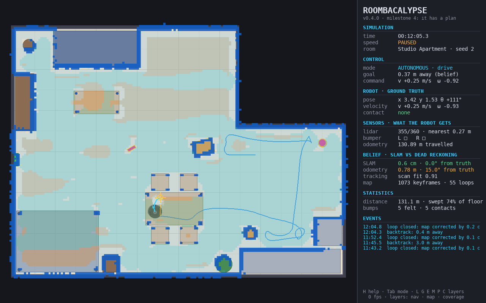

# ROOMBACALYPSE, in plain language

A round robot vacuum, in a furnished apartment, on your screen. You can drive
it yourself, or press Tab and watch it clean. The name is a joke. The robot
is not.

It maps the room, works out where it is, plans rows like someone mowing a
lawn, gets itself out of corners, and — if you pick it up and put it down
somewhere else — notices, and finds itself again. It does all of that with
the same kinds of sensors and maths a real robot would use. Dirt, a battery,
and a personality are designed and not built yet.

This page is the tour (and may be outdated). The [engineering README](README-Engineering.md) is the manual:
install details, every key, every number.



## The one rule

The program that draws the apartment knows everything: every wall, every
chair leg, the robot's exact position. The program that *is* the robot is
not allowed to read any of that.

The robot receives only what its sensors report, and it can only respond by
telling its wheels how fast to spin. Automated tests fail the build if its
code peeks at the answer. That rule is the whole project. A vacuum that
secretly reads the floor plan is a slideshow.

## A clean, start to finish

Press Tab. The robot is sitting on its charger.

1. **It backs straight off the dock.** Turning in place there would scrape

   the charger. The gap is thinner than the laser's noise, so the robot
    cannot trust a reading that close.
2. **It looks.** A laser spins and measures the distance to whatever it hits:

   walls, sofa, table legs. From those distances it starts a map made of
    small squares: empty, blocked, or not seen yet.
3. **It mows the lawn.** On the map it has so far, it plans parallel rows

   and drives them. A row stops at furniture and picks up again on the far
    side. When a big area is done, it goes back for the patches it skipped,
    largest first, so it does
    not spend the afternoon fussing over one corner while a whole room waits.
4. **It peeks into the unknown.** The edge between "I have seen this floor"

   and "I have not" is a frontier. It drives toward those edges until the
    reachable apartment is filled in. A frontier has to open onto unseen
    floor at the edge of the map. The hollow inside a sofa does not count:
    chasing those used to send it into gaps it then could not leave.
5. **It bumps, and remembers.** Some things sit below the laser. A sock does.

   So does the dog bowl. The robot drives into them, feels the hit on its
    bumper, backs off, and marks that spot so it will not charge the same
    sock all afternoon.
6. **If it gets stuck, it tries harder, in order.** Back up. Spin. Creep

   forward along a heading that looks open. Give up on this target and pick
    another. Only if the same place keeps defeating it does it admit it is
    trapped. Getting out of one corner used to make it declare the whole room
    hopeless; that is fixed.
7. **It stops when the job is done.** In the studio that takes about 25 to

   30 minutes of simulated time (you can run the clock much faster than real
    life). It has then swept a little over 90% of the floor it can physically
    reach. The rest is a few centimetres along walls, and gaps barely wider
    than the robot, which it refuses to enter.

You can also leave it in the older mode, where it just wanders and dodges.
That explores quickly and never decides it is finished. Coverage — the lawn
mowing — is the default.

## What it can sense

| Sense | What it is | What it is bad at |
|---|---|---|
| Spinning laser | Measures distance all the way around, five times a second. This is a real sensor type, usually called LiDAR. | Anything below 9.5 cm: socks, the dog bowl, a cable. The beam is a single height. |
| Bumper | Two switches, left and right. They latch on when the shell hits something. | It only knows *after* the hit. |
| Wheel counters | Tick as the wheels turn. Counting them up is how the robot guesses how far it drove. | The wheels are slightly the wrong size, on purpose, and they slip a little. Ten minutes of counting alone can be metres wrong. |
| Gyro | A small chip that feels turning, the kind in a phone. | Excellent at "which way am I facing," still a little off. Distance still comes from the wheels. |

The wheel errors are deliberate. A simulator with perfect wheels teaches the
robot bad habits. Real vacuum wheels are never identical, and a small
difference in size turns into a large error in heading. With the gyro, ten
minutes of guessing-from-motion is typically within a metre or two. Without
it, several metres and a big wrong turn.

## Where it thinks it is

Counting wheel turns is a guess, and the guess wanders. So the robot does
what real mapping robots do: every time the laser sweeps, it slides that
sweep around on the map it has already built until the two agree, then
nudges its believed position to match. When it later drives past somewhere
it has already been, it recognises the place and corrects the whole trip,
not just the latest step. The field calls the combination SLAM: mapping and
locating yourself at the same time.

In the studio it usually knows its position to about a centimetre. In the
larger apartment, error grows to a few centimetres at the far end of the
hallway, mostly because the whole map is rotated by about half a degree
around the charger. The map stays consistent with itself. Stand next to the
dock and the error is small again.

Press `E` and both guesses are drawn in the room, separate from the real robot:

- **Purple** is the wheel-and-gyro guess. It drifts.
- **Green** is the map-corrected guess. It stays close.

The map (`M`) is pinned to the real spot where the robot woke up, and then
drawn exactly as the robot believes the apartment to be. When that belief is
off, the drawing sits off the real furniture, in plain sight.


### Picking it up

Press `K` with the mouse over some open floor. The robot is carried there.
Nothing tells it. The wheels did not turn, the gyro felt no rotation, and
the program is not allowed to whisper the new coordinates.

A fraction of a second later the laser picture stops fitting the map. The
robot says it is lost, stands still or inches around for a new view, and
searches the entire map for a place where the picture would fit. In a room
it has already mapped, it finds itself on the first try: about a centimetre
off in the studio, and up to about ten centimetres in the larger apartment.
Then it goes back to cleaning.

Put it down in a room it has never seen and it cannot invent a match. It
wanders until it sees somewhere it recognises. In a nearly symmetrical room
it waits for a view that distinguishes the real spot from its mirror image,
because guessing wrong would write the new scan into the map in the wrong
place and poison every scan after that.

## The three apartments

| Room | What it is | What a long run looks like |
|---|---|---|
| **Studio** (the one that opens) | An L-shaped flat: bed, sofa, coffee table, dining set, kitchen, a sock, a dog bowl. The robot drives under the bed and the tables. It cannot drive through their legs. | About 35 m² of floor it can reach. In half an hour it sweeps about 92% and announces it is done. |
| **Apartment** | Six spaces off a 10 metre hallway: living room, kitchen, bedroom, bathroom, office, and the hall. Living room and kitchen connect to each other and to the hall, so the robot can loop. | The hard one. About 80% in half an hour, still working. A real vacuum would take an hour or more for a flat this size. |
| **Test chamber** | A small, mostly empty box. | For checking that the basics work. The robot finishes quickly. |

Once it is installed (next section):

```bash
python main.py                      # studio
python main.py --room apartment
python main.py --room test_chamber
```

## Three things worth doing

**Drop a sock in front of it.** Press `O` until the obstacle is a sock, then
click. The laser cannot see it. The robot bumps, backs off, and adds it to
the map. Amber outlines are things you can push; you can also shove the
robot into a box and watch the box slide.

**Kidnap it.** Hover over open floor and press `K`. Watch the purple ghost
stay behind at the old spot, and the green one catch up once the search
succeeds. `Shift+K` drops it somewhere random.

**Give it a collision noise.** The built-in one is a synthesised bonk:

```bash
python main.py --sound bonk
```

`V` toggles it. The original request was the scream from *Tom and Jerry*.
That recording is copyrighted, so it is not in the project and will not be.
If you have a clip of your own, keep it in the `sounds/` folder (that folder
stays on your machine) and start with `--sound sounds/your_clip.wav`.

Time can run from one-eighth speed to 64 times faster (`+` and `-`). Space
pauses. `N` advances a single instant while paused, which is the way to
watch a bump in slow motion.

## Run it

You need Python 3.12 or newer.

```bash
uv venv
uv pip install -e ".[dev]"
uv run python main.py
```

Or, with ordinary Python:

```bash
python3 -m venv .venv
source .venv/bin/activate
pip install -e ".[dev]"
python main.py
```

The window uses pygame-ce, a community continuation of pygame, because the
original pygame does not install on the newest Python versions. You import
it under the same name.

No window, ten simulated minutes, then a report card the robot is not
allowed to see:

```bash
python main.py --headless --duration 600 --seed 3
```

The report says how much floor was swept, how many bumps, how far the
wheel-guess drifted, and how close the map-corrected position was to the
truth. Same seed, same settings, same run, down to the noise. That is
checked.

Keys you will actually use:

| Key | What happens |
|---|---|
| Tab | You drive, or it drives |
| Arrows or WASD | Drive (Shift is full speed) |
| Space | Pause |
| `+` / `-` | Faster / slower |
| L | Show the laser |
| G | Show the planned path and the curves it considered |
| E | Show where it *thinks* it is |
| M | Show its map |
| C | Show swept floor and floor still to do |
| K | Pick it up and put it down at the cursor |
| H or F1 | Every other key |

The full list, and every command-line option, is in the [README](README-Engineering.md).

## How far along it is

The work is split into seven milestones. Four are done and tested.

| | In one sentence |
|---|---|
| **It moves** | A room, a robot, collisions, and a window. You can drive and push things. |
| **It sees** | Laser, bumper, wheel counters, realistic wheel error. It wanders without hitting anything the laser can see. |
| **It knows where it is** | It builds a map from nothing and corrects itself when it recognises a place. |
| **It has a plan** | Orderly coverage, getting unstuck, and finding itself after a kidnapping. This is where the project is. |
| **It cleans and comes home** | Next. Dirt that actually disappears, a battery, and returning to the dock before it dies. |
| **It has feelings** | A narrator with opinions. It comments. The planner still drives. |
| **It ships** | Benchmarks, pictures, a release. |

There is a parked idea, not scheduled: the vacuum hunts your ankles. That
needs a person in the apartment first.

## What it still gets wrong

These are known, and written down so nobody pretends otherwise.

- **It leaves a ribbon along the walls.** A few centimetres, plus anything
under low furniture the laser cannot reason about. There is no side brush
and no "follow the wall" pass yet. That is most of the floor it misses in
the studio.
- **It will not enter a gap barely wider than itself.** About 35 to 45 cm.
Trying those dead ends used to trap it. Real vacuums do go in, bumper
first. That may come with the edge pass.
- **Every lane runs the same direction,** even when a room would be faster
the other way. In the six-room apartment it is still going at the half-hour
mark.
- **A kidnapping only works if it has seen the place before.** Dropped in a
fresh room, it searches until something looks familiar. A move smaller than
about 25 cm is treated as a slip, not a kidnapping.
- **Pushes are simple.** A box slides. It does not spin. Two boxes do not
push each other. There is no real friction or momentum.
- **It cannot climb.** A cable 1 cm high is a wall. A real vacuum would roll
over it.
- **There is no dirt, no battery, and no mood.** The map's "swept" colour is
where the robot believes its body has been, which is not the same as dust
collected.
- **Your mouse session cannot be replayed.** Scripted runs with a seed can.
Clicks and kidnappings are not recorded.

## If you want the engineering

- [README-Engineering.md](README-Engineering.md) — install, every control, measured numbers, layout of the code
- [docs/ARCHITECTURE.md](docs/ARCHITECTURE.md) — how the simulator and the robot are kept apart, and why each big decision went the way it did
- [docs/ROADMAP.md](docs/ROADMAP.md) — what each milestone promised, and the measured results
- [docs/algorithms/](docs/algorithms/) — one note per algorithm, written only after the tests passed

The licence is MIT. See [LICENSE](LICENSE).
