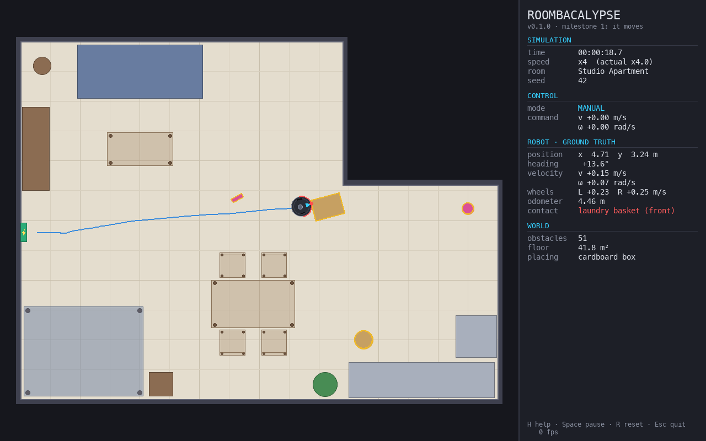

# ROOMBACALYPSE

*An unnecessarily overengineered autonomous robotic vacuum simulator.*

A 2D robotics simulation of a round robot vacuum, built with real robotics
algorithms, honest physics, and (eventually) far too many feelings. The premise
is ridiculous; the engineering is meant to be real. The robot will have to map
its world, find itself in it, plan, clean, and get itself home, without ever
peeking at the simulator's ground truth.

> **Status: Milestone 1 of 7 ("It moves").** You can drive a Roomba-sized robot
> around a furnished apartment with exact kinematics and collision physics.
> The autonomy stack (sensors, SLAM, planning, cleaning, battery, personality)
> is *designed* ([docs/ARCHITECTURE.md](docs/ARCHITECTURE.md)) but **not built
> yet**. Every feature below is marked ✅ implemented or 🗓 planned; nothing is
> claimed before it is tested.



## Features

| Feature | Status |
|---|---|
| Differential-drive kinematics: exact arc integration, curvature-preserving wheel speed limits, acceleration limits | ✅ M1 |
| Continuous 2.5D world: concave floor plans, convex furniture, circles, height bands (drive under beds, not through table legs) | ✅ M1 |
| Collision detection and response: no penetration, sliding along walls, pushable obstacles | ✅ M1 |
| Room files in TOML with furniture macros (tables, chairs); two built-in rooms | ✅ M1 |
| Pygame viewer: manual driving, pause, speed 0.125–64×, single step, reset, obstacle placement and removal, zoom/pan, trail, screenshots | ✅ M1 |
| Typed, validated, layered configuration (no hard-coded parameters) | ✅ M1 |
| Deterministic simulation (same seed and inputs → bit-identical run) | ✅ M1 |
| Architecture tests that stop the robot's software from reading ground truth | ✅ M1 |
| LiDAR, bumper and wheel encoders with noise; autonomous obstacle avoidance (Dynamic Window Approach) | 🗓 M2 |
| Occupancy grid mapping and particle-filter localization | 🗓 M3 |
| A\* path planning, coverage planning, stuck detection and recovery | 🗓 M4 |
| Dirt, vacuum, battery, energy-aware return to dock, docking, recharge and resume | 🗓 M5 |
| Personality (frustration, confidence, curiosity, battery anxiety), incident reports, statistics | 🗓 M6 |
| Benchmarks and release | 🗓 M7 |

## Installation

Requires **Python 3.12 or newer** (tested on 3.12 and 3.15).

With [uv](https://docs.astral.sh/uv/):

```bash
uv venv
uv pip install -e ".[dev]"
```

With plain pip:

```bash
python3 -m venv .venv
source .venv/bin/activate
pip install -e ".[dev]"
```

Runtime dependencies are NumPy, SciPy and **pygame-ce**. `matplotlib` is optional
(`pip install -e ".[plots]"`) for the diagnostic plots planned for later milestones.

**About pygame-ce.** The project depends on `pygame-ce`, the community-maintained
fork of pygame. It is imported as `pygame` and has the same API. We use it
because upstream `pygame` publishes no wheels for Python 3.14 or 3.15. On
Python 3.12 or 3.13 you may use upstream pygame 2.6 instead
(`pip uninstall pygame-ce && pip install pygame`), but never install both.

## Running

```bash
python main.py                        # the studio apartment
python main.py --room test_chamber    # a small empty box
python main.py --list-rooms
python main.py --seed 7 --set robot.max_wheel_speed=0.3 --set teleop.angular_speed=1.5
python main.py --config my_settings.toml
python main.py --screenshot out/frame.png --frames 60   # render offscreen, no window
```

`python -m roombacalypse` and the installed `roombacalypse` command do the same thing.

## Controls

| Key / mouse | Action |
|---|---|
| Arrows / WASD | drive (Shift: full speed) |
| Space | pause / resume |
| N | single physics step while paused |
| `+` / `-` | faster / slower simulation |
| R / Shift+R | reset (same seed / next seed) |
| Left click | place an obstacle (preview follows the mouse) |
| O | cycle obstacle type: cardboard box, pillar, sock, ottoman |
| X | remove the obstacle under the cursor (whole table/chair) |
| Mouse wheel | zoom at cursor |
| Middle drag, or Alt + left drag | pan |
| 0 | fit room to window |
| T | toggle trail |
| F12 | save a screenshot to `out/` |
| H / F1 | help overlay |
| Esc / Q | quit |

Hover over furniture to see what it is, its height band, and whether it moves.
Amber outlines mark movable objects. Translucent furniture is overhead: the
robot can drive underneath.

Planned bindings: `Tab` manual/autonomous (M2), `L` LiDAR rays (M2),
`M` occupancy map and `P` particles (M3), `G` planned path and `C` coverage
(M4), right-click to spawn dirt (M5).

## Configuration

All tunables live in typed dataclasses (`roombacalypse/core/config.py`) and are
documented in [`config/default.toml`](config/default.toml). To change them,
pass a TOML file with only the keys you want (`--config`) or single values
(`--set section.key=value`). Unknown keys and invalid values are errors, so a
typo cannot fall back silently to a default.

Rooms are TOML files in [`config/rooms/`](config/rooms/). The studio file is
annotated and shows every shape type and the `table` and `chair` macros.

## Tests and checks

```bash
pytest                                                          # 199 tests, ~2 s
uvx ruff check roombacalypse tests                              # lint (optional tool)
uvx mypy roombacalypse --python-executable .venv/bin/python     # type check (optional tool)
```

The suite includes a property test (60 s of random driving through the
furnished studio never penetrates anything), a bit-for-bit determinism test,
and architecture tests that fail if the robot's software imports ground truth,
if anything but the viewer imports pygame, or if packages form import cycles.

## Architecture overview

```
           GROUND TRUTH (simulator)                    BELIEF (robot software)
  environment · robot · simulation           mapping · localization · planning
  (sensors · cleaning · battery)             navigation · autonomy
                 │                                          ▲
                 │  SensorFrame  ─────── the only ───────►  │
                 │  ◄─────── DriveCommand  crossing         │
                 ▼                                          │
                              core (shared kernel)
           geometry · kinematics · messages · config · RNG streams

  harness (reads both sides, writes neither): visualization · evaluation · app.py
  observer (events only): personality
```

- **The wall of truth.** The robot's software sees only sensor frames, never the
  simulator's state. Tests enforce this, so "autonomy" cannot quietly cheat.
- **Physics is separate from rendering.** The engine runs headless; the pygame
  viewer only reads it.
- **Deterministic.** Fixed timestep, integer-multiple rates, named random
  streams derived from one seed.
- **Continuous geometry, not a grid.** The robot's map has to be *inferred*
  from sensors, as on a real robot.

Read more:

- [docs/ARCHITECTURE.md](docs/ARCHITECTURE.md): full design and decision log
- [docs/ROADMAP.md](docs/ROADMAP.md): milestones, dependencies, acceptance criteria, risks
- [docs/algorithms/](docs/algorithms/): one document per algorithm, with derivations and limitations

### Repository layout

```
main.py                 launcher
config/                 default.toml + rooms/*.toml
roombacalypse/
  core/                 geometry, kinematics, messages, config, RNG, paths
  environment/          shapes, world, room loader, placeable catalog
  robot/                drivetrain, body state
  simulation/           clock, contact solver, engine
  autonomy/             robot software (M1: teleoperation)
  visualization/        camera, renderer, HUD, viewer
  app.py                CLI and composition root
tests/                  pytest suite
docs/                   architecture, roadmap, algorithm notes
```

The brief suggested fourteen top-level packages. They live inside one
`roombacalypse` package instead, to avoid import-name collisions; see decision
D1 in the architecture document.

## Current limitations

Honest list for Milestone 1:

- **No autonomy yet.** The robot only moves when you drive it. Sensors arrive in M2.
- **Simplified contact physics.**
  - Pushed objects slide but never rotate.
  - No chain pushing (box into box).
  - A push into a wall is cancelled rather than deflected.
  - No friction, mass or momentum.
- **No climbing.** Anything inside the robot's height band blocks it, even a
  1 cm cable; real robots climb about 1.5 cm.
- **No wheel slip or calibration error yet** (M2). Odometry would be perfect
  if it existed.
- **Your edits are not reproducible.** Interactive input (keyboard, placed
  obstacles) is not recorded, so manual sessions cannot be replayed.
- The robot is a perfect circle. Real robot vacuums are close, D-shaped ones are not.
- The project runs from a source checkout, which is where `config/` is found.
  Override the location with `ROOMBACALYPSE_CONFIG_DIR`.

## Roadmap

| | Milestone | What you will see |
|---|---|---|
| ✅ | **M1: It moves** | drive a robot around a furnished room, push socks |
| ⏭ | **M2: It sees** | LiDAR rays, bump sensors, autonomous wandering without crashing |
| 🗓 | **M3: It knows where it is** | a map appearing from nothing, a particle cloud collapsing onto the robot |
| 🗓 | **M4: It has a plan** | planned paths, methodical coverage, escaping chair-leg traps |
| 🗓 | **M5: It cleans and comes home** | dirt disappearing, battery anxiety, docking, resuming |
| 🗓 | **M6: It has feelings** | frustration meters, incident reports, unsolicited commentary |
| 🗓 | **M7: It ships** | benchmarks, plots, release |

Details, acceptance criteria and risks: [docs/ROADMAP.md](docs/ROADMAP.md).

## License

MIT; see [LICENSE](LICENSE).
