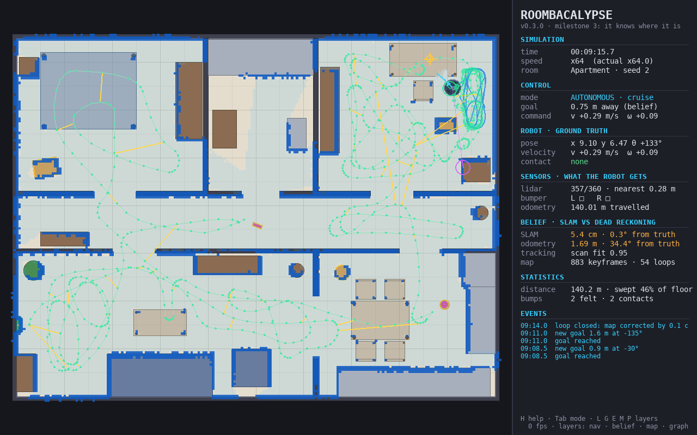

# ROOMBACALYPSE

*An unnecessarily overengineered autonomous robotic vacuum simulator.*

A 2D robotics simulation of a round robot vacuum, built with real robotics
algorithms, honest physics, and (eventually) far too many feelings. The premise
is ridiculous; the engineering is meant to be real. The robot will have to map
its world, find itself in it, plan, clean, and get itself home, without ever
peeking at the simulator's ground truth.

> **Status: Milestone 3 of 7 ("It knows where it is").** Press Tab and the
> robot drives itself. It explores using only its simulated LiDAR, bumper and
> wheel encoders, and builds a map as it goes. It also knows where it is in
> that map: graph SLAM with scan matching and loop closure keeps it within
> about a centimetre of the truth, while its wheel odometry drifts by metres.
> Planning, cleaning, battery and personality are *designed*
> ([docs/ARCHITECTURE.md](docs/ARCHITECTURE.md)) but not built yet. Every
> feature below is marked ✅ implemented or 🗓 planned; nothing is claimed
> before it is tested.



## Features

| Feature | Status |
|---|---|
| Differential-drive kinematics: exact arc integration, curvature-preserving wheel speed limits, acceleration limits | ✅ M1 |
| Continuous 2.5D world: concave floor plans, convex furniture, circles, height bands (drive under beds, not through table legs) | ✅ M1 |
| Collision detection and response: no penetration, sliding along walls, pushable obstacles | ✅ M1 |
| Room files in TOML with furniture macros (tables, chairs); two built-in rooms | ✅ M1 |
| Pygame viewer: driving, pause, speed 0.125–64×, single step, reset, obstacle placement and removal, zoom/pan, trail, screenshots | ✅ M1 |
| Typed, validated, layered configuration (no hard-coded parameters) | ✅ M1 |
| Deterministic simulation (same seed and inputs → bit-identical run, noise included) | ✅ M1–M2 |
| Architecture tests that stop the robot's software from reading ground truth | ✅ M1 |
| 2D LiDAR: vectorized ray casting, height-band visibility, range-dependent noise, dropouts | ✅ M2 |
| Bumper (left/right switches) and wheel encoders | ✅ M2 |
| Hidden per-robot wheel calibration errors and correlated slip: odometry drifts realistically | ✅ M2 |
| Autonomous exploration: Dynamic Window Approach obstacle avoidance, bump reflex, map-free goal picking | ✅ M2 |
| Headless runs with a ground-truth scorecard; event log | ✅ M2 |
| Graph SLAM: scan matching (correlative search + point-to-line ICP), pose graph, loop closure | ✅ M3 |
| Log-odds occupancy grid map, drawn where it really is so map errors show | ✅ M3 |
| A multi-room apartment: six spaces off a 10 m hallway, with a loop | ✅ M3 |
| Ground-truth scoring of localization and mapping (trajectory error, map precision/recall) | ✅ M3 |
| A\* path planning, coverage planning, stuck detection and recovery | 🗓 M4 |
| Dirt, vacuum, battery, energy-aware return to dock, docking, recharge and resume | 🗓 M5 |
| Personality (frustration, confidence, curiosity, battery anxiety), incident reports | 🗓 M6 |
| Benchmarks and release | 🗓 M7 |

## Installation

Requires **Python 3.12 or newer** (tested on 3.12 and 3.15).

With [uv](https://docs.astral.sh/uv/):

```bash
uv venv
uv pip install -e ".[dev]"
```

With plain pip:

```bash
python3 -m venv .venv
source .venv/bin/activate
pip install -e ".[dev]"
```

Runtime dependencies are NumPy, SciPy and **pygame-ce**. `matplotlib` is optional
(`pip install -e ".[plots]"`) for the diagnostic plots planned for later milestones.

**About pygame-ce.** The project depends on `pygame-ce`, the community-maintained
fork of pygame. It is imported as `pygame` and has the same API. We use it
because upstream `pygame` publishes no wheels for Python 3.14 or 3.15. On
Python 3.12 or 3.13 you may use upstream pygame 2.6 instead
(`pip uninstall pygame-ce && pip install pygame`), but never install both.

## Running

```bash
python main.py                        # the studio apartment; press Tab to let the robot drive
python main.py --mode auto            # start autonomous
python main.py --room test_chamber    # a small empty box
python main.py --room apartment       # six rooms off a hallway: the SLAM stress test
python main.py --list-rooms
python main.py --seed 7 --set dwa.max_speed=0.2 --set lidar.dropout_probability=0.1
python main.py --config my_settings.toml

# No window: simulate 10 minutes as fast as possible and print a ground-truth scorecard
python main.py --headless --duration 600 --seed 3
python main.py --screenshot out/frame.png --frames 60 --mode auto   # render offscreen
```

`python -m roombacalypse` and the installed `roombacalypse` command do the same thing.

A headless scorecard looks like this (studio, seed 3, actual output):

```
coverage        72.4 % of 34.9 m² accessible floor
bumps           6 (0.60/min); simulator saw 5 contacts, 0 with things the LiDAR can see
penetration     none
odometry drift  4.35 m, 112.9° after 600 s
SLAM pose error 0.7 cm RMS, 1.9 cm max; heading 0.39° RMS, 1.7° max
SLAM keyframes  856, ATE 0.7 cm RMS (0.5 cm aligned); 68 loop closures in 69 attempts
map             precision 100.0 % (surface only 75.5 %), recall 92.0 %, 1650 occupied cells
```

The odometry line is what the robot's wheels alone would believe: metres off
after ten minutes. The SLAM lines are where it actually believed it was, and
how good its map is, scored against ground truth the robot never sees.

## Controls

| Key / mouse | Action |
|---|---|
| Tab | switch manual ↔ autonomous |
| Arrows / WASD | drive, in manual mode (Shift: full speed) |
| Space | pause / resume |
| N | single physics step while paused |
| `+` / `-` | faster / slower simulation |
| R / Shift+R | reset (same seed / next seed) |
| L | LiDAR rays and hits |
| G | navigation: exploration goal, DWA candidate arcs, chosen arc |
| E | belief: where odometry (purple) and SLAM (green) *think* the robot is |
| M | the robot's map (on by default), drawn through its true boot pose so errors show |
| P | pose graph: keyframes (green) and loop closures (yellow) |
| T | ground-truth trail |
| Left click | place an obstacle (preview follows the mouse) |
| O | cycle obstacle type: cardboard box, pillar, sock, ottoman |
| X | remove the obstacle under the cursor (whole table/chair) |
| Mouse wheel | zoom at cursor |
| Middle drag, or Alt + left drag | pan |
| 0 | fit room to window |
| F12 | save a screenshot to `out/` |
| H / F1 | help overlay |
| Esc / Q | quit |

Hover over furniture to see what it is, its height band, and whether it moves.
Amber outlines mark movable objects. Translucent furniture is overhead: the
robot can drive underneath, and its LiDAR sees straight through it.

Try dropping a sock (O, then click) in front of the autonomous robot. The
LiDAR can't see it, so the robot bumps, backs off and remembers it for 20 s.

The panel separates what is *true* (ground truth) from what the robot
*senses* and *believes*, and keeps a live, colour-coded event log.

Planned bindings: `C` coverage (M4), right-click to spawn dirt (M5).

## Configuration

All tunables live in typed dataclasses (`roombacalypse/core/config.py`) and are
documented in [`config/default.toml`](config/default.toml). That includes
sensor noise, the hidden drive errors, and DWA and exploration parameters. To
change them, pass a TOML file with only the keys you want (`--config`) or
single values (`--set section.key=value`). Unknown keys and invalid values are
errors, so a typo cannot fall back silently to a default.

Rooms are TOML files in [`config/rooms/`](config/rooms/). The studio file is
annotated and shows every shape type and the `table` and `chair` macros.

## Tests and checks

```bash
pytest                                                          # ~375 tests, ~30 s
pytest -m slow                                                  # milestone acceptance runs, ~8 min
uvx ruff check roombacalypse tests                              # lint (optional tool)
uvx mypy roombacalypse --python-executable .venv/bin/python     # type check (optional tool)
```

Highlights:

- **LiDAR:** checked against hand-computed distances and noise statistics.
- **Closed-loop DWA:** tests drive the real simulator through LiDAR and odometry
  around a pillar and up to a wall without contact.
- **Property tests:** random driving never penetrates anything; DWA always
  picks an arc it can brake on.
- **Determinism:** bit-for-bit, with all noise on.
- **Architecture tests:** they fail if the robot's software imports ground truth.
- **SLAM:** with perfect sensors it is millimetre-accurate. With a 3 %
  wheel-base error it is ten times better than dead reckoning. It closes
  driven loops, survives wheel slip, and its map is scored against ground
  truth. The scan matcher was checked for bias against an oracle map.
- **Acceptance suite:** 10 simulated minutes × 5 seeds × 3 rooms. It asserts no
  penetration, zero contacts with anything the LiDAR can see, no stalls, a
  bump-rate ceiling and a coverage floor. It also asserts SLAM pose error and
  map precision/recall: about 1 cm RMS in the studio, 3–5 cm in the apartment,
  measured.

## Architecture overview

```
           GROUND TRUTH (simulator)                    BELIEF (robot software)
  environment · robot · sensors · simulation   localization · navigation · autonomy
  (cleaning · battery)                         (mapping · planning)
                 │                                          ▲
                 │  SensorFrame  ─────── the only ───────►  │  encoders, bumper, LiDAR
                 │  ◄─────── DriveCommand  crossing         │
                 ▼                                          │
                              core (shared kernel)
       geometry · kinematics · messages · events · config · RNG streams

  harness (reads both sides, writes neither): visualization · evaluation · app.py
  observer (events only): personality
```

- **The wall of truth.** The robot's software sees only sensor frames, never the
  simulator's state, and not even its own true wheel sizes. Tests enforce this,
  so "autonomy" cannot quietly cheat.
- **Physics is separate from rendering.** The engine runs headless; the pygame
  viewer only reads it.
- **Deterministic.** Fixed timestep, integer-multiple rates, named random
  streams derived from one seed.
- **Continuous geometry, not a grid.** The robot's map has to be *inferred*
  from sensors, as on a real robot.

Read more:

- [docs/ARCHITECTURE.md](docs/ARCHITECTURE.md): full design and decision log
- [docs/ROADMAP.md](docs/ROADMAP.md): milestones, acceptance criteria with measured results, risks
- [docs/algorithms/](docs/algorithms/): kinematics, collisions, LiDAR, odometry and drive errors, DWA and
  exploration, graph SLAM

### Repository layout

```
main.py                 launcher
config/                 default.toml + rooms/*.toml
roombacalypse/
  core/                 geometry, kinematics, messages, events, config, RNG, paths
  environment/          shapes, world, room loader, placeable catalog
  robot/                drivetrain, wheel/ground error model, body state
  sensors/              ray casting, LiDAR, bumper, encoders
  simulation/           clock, contact solver, engine
  mapping/              occupancy grid, surface fields, pose-graph optimizer
  localization/         wheel odometry, scan matching, graph SLAM
  navigation/           obstacle memory, Dynamic Window Approach
  autonomy/             the robot's brain, teleoperation, exploration behaviour
  evaluation/           ground-truth metrics, coverage, headless scenarios
  visualization/        camera, renderer, HUD, viewer
  app.py                CLI and composition root
tests/                  pytest suite (+ slow acceptance scenarios)
docs/                   architecture, roadmap, algorithm notes
```

The brief suggested fourteen top-level packages. They live inside one
`roombacalypse` package instead, to avoid import-name collisions; see decision
D1 in the architecture document.

## Current limitations

Honest list as of Milestone 3:

- **The map is not used for planning yet.** The robot still explores at
  random, now with a visit counter in its map frame that no longer smears.
  Systematic coverage needs Milestone 4's planner; in the apartment, random
  wandering reaches about half the floor in 10 minutes.
- **SLAM has no global relocalization.** A robot picked up and put down
  elsewhere stays lost; it notices, and keeps those scans out of its map.
  Loop closure searches a bounded window (±0.5 m, ±12°).
- **Absolute error grows away from the dock** across long corridors until a
  loop closes: about 5 cm in the apartment's far office, mostly heading drift.
  A gyroscope would bound it.
- **Odometry drifts:** up to several metres and 100°+ per 10 minutes. That is
  deliberate realism, and SLAM corrects it; no gyro is modelled (yet).
- **DWA is a local planner.** It handles the obstacles tested, but U-shaped
  traps and dead ends can still fool it; Milestone 4 adds global planning
  and recovery.
- **The LiDAR sweep is instantaneous.** No motion distortion, beam divergence
  or reflectivity effects.
- **Simplified contact physics.**
  - Pushed objects slide but never rotate.
  - No chain pushing (box into box).
  - A push into a wall is cancelled rather than deflected.
  - No friction, mass or momentum.
- **No climbing.** Anything inside the robot's height band blocks it, even a
  1 cm cable; real robots climb about 1.5 cm.
- **Your edits are not reproducible.** Interactive input is not recorded, so
  manual sessions cannot be replayed.
- **Coverage is approximate.** The accessible-floor estimate is computed once
  per reset, so obstacles you place later don't update it.
- The project runs from a source checkout, which is where `config/` is found.
  Override the location with `ROOMBACALYPSE_CONFIG_DIR`.

## Roadmap

| | Milestone | What you will see |
|---|---|---|
| ✅ | **M1: It moves** | drive a robot around a furnished room, push socks |
| ✅ | **M2: It sees** | LiDAR rays, bump reflexes, autonomous exploration without crashing, drifting odometry |
| ✅ | **M3: It knows where it is** | a map appearing from nothing, loops snapping shut, a multi-room apartment |
| ⏭ | **M4: It has a plan** | planned paths, methodical coverage, escaping chair-leg traps |
| 🗓 | **M5: It cleans and comes home** | dirt disappearing, battery anxiety, docking, resuming |
| 🗓 | **M6: It has feelings** | frustration meters, incident reports, unsolicited commentary |
| 🗓 | **M7: It ships** | benchmarks, plots, release |

Details, acceptance criteria and risks: [docs/ROADMAP.md](docs/ROADMAP.md).

## License

MIT; see [LICENSE](LICENSE).
